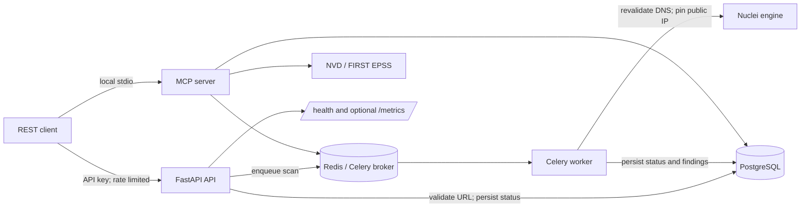

# Architecture

Avron keeps request handling, scan execution, persistence, and optional analysis in separate components.

## Request flow

1. The REST API or MCP tool validates the submitted HTTP(S) URL. Validation rejects URL credentials, private/reserved addresses, and names with any non-global DNS answer.
2. The API writes an `in_progress` record and enqueues a Celery task in Redis. The request returns a scan ID without waiting for Nuclei.
3. The worker repeats DNS validation immediately before scanning and passes Nuclei a pinned public address. It retains the hostname for HTTP Host and TLS SNI routing.
4. PostgreSQL stores scan state and findings. Clients poll the authenticated REST status endpoint or call the MCP status tool.
5. MCP analysis tools can enrich CVE findings from NVD and FIRST EPSS, generate a structured report, retrieve target history, and compare completed scans.

## Components and boundaries

- `app/main.py`: FastAPI routes, authentication, rate limiting, operational endpoints, and API documentation.
- `app/models.py` and `app/scanner.py`: target validation, DNS pinning, and Nuclei process execution.
- `app/celery_worker.py`: Celery task registration and scan dispatch.
- `app/storage_db.py`, `app/models_db.py`, `migrations/`: PostgreSQL persistence and schema migrations.
- `app/mcp_server.py`: stdio MCP tools. It is intended for trusted local clients and shares the Redis queue and PostgreSQL store.
- `app/enrichment.py` and `app/report.py`: optional external CVE/EPSS enrichment and local report/comparison logic.
- `app/metrics.py`: scan metrics. FastAPI request metrics are exposed only when `METRICS_ENABLED=true`.

The worker runs Nuclei with conservative request limits and excludes high-impact template categories by default. This reduces risk but does not make scanning harmless. Run only against authorized targets and apply network egress controls appropriate to the deployment.

## Persistence and failure behavior

Alembic migrations run before the API and worker start in Compose. A queued scan depends on Redis and the Celery worker being available. PostgreSQL records are the source of truth for scan state; a Redis outage prevents new tasks from being queued. Enrichment is best-effort and depends on external services, so missing enrichment data does not replace the underlying Nuclei findings.

## Security boundaries

The REST API requires `X-API-KEY` for scan operations, and the default Compose port bindings are loopback-only. The stdio MCP server does not add a separate user-authentication layer; access control is provided by the local MCP client and operating system. Do not expose it through a network bridge without adding a reviewed authentication and transport layer.
